  

I build web systems end to end, from data to interface. Right now I'm an intern at **CDA Zema**, working on internal tools in React and TypeScript, and on automated reports that replace manual logistics processes.

I learn by building complete projects and understanding how each piece works. Most of my attention goes to back-end, APIs and software architecture, and I'm curious about security.

 

### Stack

`TypeScript` `React` `Node.js` `NestJS` `Fastify` `Python` `PostgreSQL` `Prisma` `Docker`

Also used: Tailwind, Vite, Zod, Express, Django/Flask, MongoDB, JWT.

 

### Projects

| | |
|---|---|
| **[trampodev](https://github.com/danielluisborges/trampodev)** | Job aggregator hub: role, company, stack, location and the original link, all in one place. |
| **[todolist_ts](https://github.com/danielluisborges/todolist_ts)** | Full stack task manager with auth. React, Fastify, Prisma, PostgreSQL. In progress. |
| **Forum API** | NestJS + TypeScript API with layered architecture, validation and Swagger/Scalar docs. |
| **[ecommerce-scraper](https://github.com/danielluisborges/ecommerce-scraper)** | Python automation that collects and compares product prices across online stores. |

 

  
  

